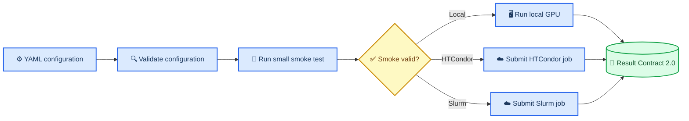

# Getting started

This guide is the shortest path from a fresh checkout to understanding and
modifying the library.

## 1. Install and run the offline check

The default installation has no CUDA dependency and is sufficient for config
validation, the fake backend, external-batch preparation/parsing, and tests:

```bash
uv sync --all-groups
uv run llms-experiments validate experiments/matrix_smoke.yaml
uv run llms-experiments run experiments/matrix_smoke.yaml --backend fake --rows 2
```

The fake backend makes deterministic responses, so this check does not need a
model, GPU, endpoint, or API key. Use `uv run llms-experiments doctor` to
inspect the local package and GPU/driver visibility.

## 📋 The minimum run contract

To execute a run, provide one YAML file containing `run`, `model`,
`variants`, and `output`, plus exactly one of `input` or `datasets`. The
configuration must also point to every prompt, schema, and input asset that it
uses.

| Required item | Where it is declared | Why it is needed |
|---|---|---|
| Run identity and seed | `run.id`, optionally `run.seed` | Names the run and makes the intended randomisation explicit |
| Input rows | `input` for one source, or `datasets` for a matrix | Supplies stable IDs, text, and optional gold labels |
| Model transport | `model.name`, `model.backend` | Selects the model and the engine that generates raw evidence |
| Semantic strategy | `variants` | Defines prompts, schemas, and processor stages |
| Durable destination | `output.directory` and optional `output.format` | Stores resumable, contract-compliant results |
| Referenced assets | Prompt Markdown, JSON schemas, and source files | Defines the exact request and validation contract |
| Runtime access | GPU/dependency installation and credentials for real models | Makes the selected backend usable; the fake backend needs neither |

The run produces inference artefacts, not accuracy or axiom metrics. The
standard outputs are described in [What the run produces](#what-the-run-produces)
below; predictive and ProtoEthos evaluation is a separate downstream step.

## Repository overview

This repository is an inference and experiment-execution framework, not a
model-training repository. The configuration describes the complete run:
input data, model backend, Markdown prompt templates, processor stages,
resource and retry controls, and output format.

The run lifecycle is:

```text
YAML configuration
  -> input reader and normalized rows
  -> prompt rendering and processor preparation
  -> backend generation
  -> semantic result processing
  -> durable Parquet, CSV, or JSONL output
```

The four main concerns are independent:

1. **Input readers** load CSV, TSV, JSONL, Parquet, nested JSON, or paired TSV
   data and preserve a deterministic `_source_position`.
2. **Backends** execute requests through vLLM, llama.cpp,
   OpenAI-compatible endpoints, or the deterministic `fake` backend. They
   return raw text and token evidence; they do not interpret labels.
3. **Processors** own semantic interpretation: parsing, schema validation,
   fan-out, candidate log probabilities, confidence extraction, and result
   construction.
4. **Output stores** write the common Result Contract 2.0 to Parquet, CSV, or
   JSONL, including atomic parts and SQLite-backed resume state.

The same processor is used by in-process inference and external batch parsing.
This is the key design rule to preserve when extending the system: backend
transport and result semantics must remain separate.

Every run records a manifest, effective configuration, provenance hashes, row
statuses, and resource diagnostics. Interrupted runs can resume from durable
rows without duplicating result identities. Generated outputs and model
artifacts should not be committed to Git.

## 🧭 Choose an execution mode

The same YAML run can be executed locally or wrapped by a scheduler. Start
locally with the fake backend, then run a small real-model smoke test before
committing a large GPU allocation. HTCondor and Slurm are optional wrappers:
they provide resource allocation and logging, while `llms-experiments` still
owns configuration, batching, retries, resume, and output validation.



### Local GPU execution

Install the GPU extra and check the driver before downloading a model:

```bash
uv sync --all-groups --extra gpu
uv run llms-experiments doctor
nvidia-smi
```

Set the data directory and Hugging Face authentication in the shell, rather
than in YAML or a scheduler file:

```bash
export DATA_ROOT=/absolute/path/to/protoethos-data
export HF_TOKEN=...                 # do not print or commit this value
export MODEL_ID=org/model-name
export MODEL_SLUG=my_model_json_only
```

The data directory must contain the assets referenced by
[`configs/protoethos/protoethos_full_matrix.yaml`](../configs/protoethos/protoethos_full_matrix.yaml),
including the three conventional corpora, ValueEval, and `protoethos.csv`.

Validate the real-model configuration without generating output:

```bash
uv run llms-experiments validate \
  configs/protoethos/protoethos_full_matrix.yaml \
  --model "$MODEL_ID" \
  --backend vllm \
  --run-id "${MODEL_SLUG}_smoke" \
  --output "results/${MODEL_SLUG}_smoke" \
  --variants single_label_json,multi_label_json
```

Run two rows from every lane as a smoke test:

```bash
uv run llms-experiments run \
  configs/protoethos/protoethos_full_matrix.yaml \
  --model "$MODEL_ID" \
  --backend vllm \
  --run-id "${MODEL_SLUG}_smoke" \
  --output "results/${MODEL_SLUG}_smoke" \
  --variants single_label_json,multi_label_json \
  --rows 2 \
  --set model.gpu_memory_utilization=0.90 \
  --set model.max_num_seqs=8 \
  --set batch.size=4 \
  --set model.enforce_eager=false
```

Only start the full run after the smoke output has a manifest and readable
Parquets for both variants:

```bash
uv run llms-experiments run \
  configs/protoethos/protoethos_full_matrix.yaml \
  --model "$MODEL_ID" \
  --backend vllm \
  --run-id "${MODEL_SLUG}_full_json_only" \
  --output "results/${MODEL_SLUG}_full_json_only" \
  --variants single_label_json,multi_label_json \
  --set model.gpu_memory_utilization=0.90 \
  --set model.max_num_seqs=16 \
  --set batch.size=8 \
  --set model.enforce_eager=false
```

`--set` accepts dotted configuration paths and is applied before typed
validation. Start with conservative values and increase `max_num_seqs` or
`batch.size` only after observing stable batches. If the GPU runs out of memory,
reduce both values. Do not delete `.resume.sqlite` when a run is interrupted.

For a model-specific configuration, copy the YAML into a new experiment file
and change only the model identity and hardware settings. Keep prompts and
schemas external to Python code. Do not reuse an output directory from another
model or revision.

### Finding the batch-size sweet spot

For a GPU throughput check, use the standalone search script. It loads the
same YAML, prompt resources, processors, and backend as a normal run, but it
does not create experiment Parquets. It keeps one backend warm, tests each
selected variant, doubles the batch size after successful trials, and then
uses binary search between the last safe size and the first out-of-memory
size. Only genuine memory failures are used as the upper-bound signal; other
backend failures stop the search so they cannot be mistaken for a safe limit.

The default variants are the two JSON-only strategies. Provide enough rows to
cover the largest candidate, and use a new report path for each model and
hardware configuration:

```bash
uv run python scripts/search_batch_size.py \
  configs/protoethos/protoethos_full_matrix.yaml \
  --dataset mftc \
  --rows 1024 \
  --start-batch 8 \
  --max-batch 1024 \
  --repeats 2 \
  --output results/batch_search/qwen36_27b_mftc.json \
  --set model.name=Qwen/Qwen3.6-27B \
  --set model.backend=local_vllm \
  --set model.enforce_eager=false
```

The atomic JSON report contains the resolved model metadata, configuration
hash, dataset and variants, every trial, GPU telemetry, the highest safe
batch, the first failed batch when found, and the throughput-best batch with
`samples_per_second` and `tokens_per_second`. A successful search therefore
records both the memory boundary and the empirically fastest tested point.
The benchmark is read-only with respect to normal result outputs, so its JSON
report can be discarded without affecting a resumable experiment.

### Local validation checkpoint

```bash
uv run python -c '
from pathlib import Path
import pyarrow.parquet as pq

root = Path("results/my_model_json_only_smoke")
files = list(root.rglob("single_label_json.parquet"))
files += list(root.rglob("multi_label_json.parquet"))
for path in files:
    print(path, pq.read_metadata(path).num_rows)
print("final variant files:", len(files))
print("manifests:", len(list(root.rglob("manifest.json"))))
'
```

A successful full-size lane has `manifest.json`,
`single_label_json.parquet`, `multi_label_json.parquet`, `results.parquet`,
`effective_config.yaml`, and `.resume.sqlite`. A Parquet part alone means
progress, not completion. Invalid rows remain explicit in the output and must
not be silently removed.

## ☁️ Optional scheduler execution

Schedulers should wrap the same command used locally. Do not put experiment
semantics into scheduler-specific scripts. The scheduler layer should specify
the GPU, CPU, memory, wall-clock limit, environment, output log paths, and
priority; the YAML and CLI should specify the model, datasets, variants,
prompts, processors, and output contract.

### HTCondor

The repository contains project-specific examples under
[`internal_documentation/`](../internal_documentation/). Start with
[`submit_json_only_smoke.sub`](../internal_documentation/submit_json_only_smoke.sub)
for a smoke test and inspect the generated environment before submitting a
full run. A minimal local-style descriptor is:

```condor
universe        = vanilla
request_gpus    = 1
request_cpus    = 16
request_memory  = 128GB
request_disk    = 20GB
requirements    = regexp("A100", TARGET.Gpus_DeviceName)
priority        = 100000
getenv          = True
should_transfer_files = NO

executable      = /absolute/path/to/run_local_model.sh
output          = logs/model.$(Cluster).$(Process).out
error           = logs/model.$(Cluster).$(Process).err
log             = logs/model.$(Cluster).$(Process).log

queue 1
```

`run_local_model.sh` should export `DATA_ROOT`, `HF_TOKEN` or the approved
credential mechanism, and invoke the same `uv run llms-experiments run` command
shown above. Check the descriptor before submission:

```bash
condor_submit -dry-run=submit_model.cmd submit_model.sub
condor_submit submit_model.sub
condor_q
condor_q -better-analyze <cluster.proc>
```

Use a pinned model revision and a unique `MODEL_SLUG`. If a job is interrupted,
resubmit against the same output directory only when no equivalent job is
queued or running. Preserve the previous logs, manifest, parts, and resume
database.

### Slurm

Create a small wrapper such as `run_model.slurm`:

```bash
#!/usr/bin/env bash
#SBATCH --job-name=my_model_json
#SBATCH --gres=gpu:1
#SBATCH --cpus-per-task=16
#SBATCH --mem=128G
#SBATCH --time=2-00:00:00
#SBATCH --output=logs/my_model.%j.out
#SBATCH --error=logs/my_model.%j.err

set -euo pipefail
cd /absolute/path/to/llms-experiments
export DATA_ROOT=/absolute/path/to/protoethos-data
export MODEL_ID=org/model-name
export MODEL_SLUG=my_model_json_only

uv run llms-experiments run \
  configs/protoethos/protoethos_full_matrix.yaml \
  --model "$MODEL_ID" \
  --backend vllm \
  --run-id "${MODEL_SLUG}_full" \
  --output "results/${MODEL_SLUG}_full" \
  --variants single_label_json,multi_label_json \
  --set model.enforce_eager=false
```

Submit and monitor it with:

```bash
sbatch run_model.slurm
squeue --me
sacct -j <job-id> --format=JobID,State,Elapsed,MaxRSS,AllocTRES
```

The exact Slurm GPU and partition flags are site-specific. Replace
`--gres=gpu:1` and add the required `--partition` or `--constraint` for the
target machine. The result and resume rules are identical to local and
HTCondor execution.

## ⚙️ Configuration parameters

An experiment is defined by a YAML configuration file. For a first run, use
the small [`experiments/matrix_smoke.yaml`](../experiments/matrix_smoke.yaml)
example. For the full ProtoEthos evaluation, use
[`configs/protoethos/protoethos_full_matrix.yaml`](../configs/protoethos/protoethos_full_matrix.yaml).
The latter is one reusable matrix: it defines the datasets and variants once,
then the CLI can replace the model, backend, run ID, and output directory for
each model without copying the matrix.

### How the YAML file is organised

The top-level sections describe different responsibilities. A minimal
configuration has the following shape:

```yaml
# Save this file as experiments/getting_started_smoke.yaml. Because it lives
# under experiments/, relative paths below resolve from the repository root.

run:
  id: getting_started_smoke       # Stable name used in manifests and row IDs.
  seed: 123                       # Record the intended random seed.
  dataset_labels: [care, harm]   # Taxonomy available to prompts/processors.
  prompt_parts:                  # Reusable theory context for context.md.
    theory: experiment-cli/prompt/theory-mft.md
    definitions: experiment-cli/prompt/definitions-mft.md

input:                            # Use input for one source; use datasets for a matrix.
  path: experiment-cli/data/smoke.parquet  # Source rows to annotate.
  format: parquet                  # Reader selected by the input format.
  id_column: id                    # Stable source identifier column.
  text_column: text                # Text inserted into the prompt.

model:
  name: fake                       # Replace with a pinned model ID for real inference.
  backend: fake                    # Offline backend; alternatives include local_vllm.
  # revision: exact-model-revision # Pin this for a real model and reproducibility.

variants:
  - id: single_label_json
    max_tokens: 32                 # Generation budget for this response shape.
    prompts:                        # Concatenated, ordered prompt assets.
      - experiment-cli/prompt/system.md
      - experiment-cli/prompt/context.md
      - experiment-cli/prompt/task-single-label.md
      - experiment-cli/prompt/output-json.md
      - experiment-cli/prompt/input.md
    processor:
      result: single_label           # Semantic result_type in the output rows.
      stages:
        - type: json_decode           # Turn generated text into a JSON value.
        - type: json_schema            # Validate the value and constrain generation.
          schema: experiment-cli/prompt/schema-single-label.json
          enum_from: dataset_labels   # Use this run's taxonomy as the enum.

  - id: multi_label_json              # A second strategy over the same input rows.
    max_tokens: 48
    prompts:
      - experiment-cli/prompt/system.md
      - experiment-cli/prompt/context.md
      - experiment-cli/prompt/task-multi-label.md
      - experiment-cli/prompt/output-json.md
      - experiment-cli/prompt/input.md
    processor:
      result: multi_label
      stages:
        - type: json_decode
        - type: json_schema
          schema: experiment-cli/prompt/schema-multi-label.json
          enum_from: dataset_labels

batch:
  mode: fixed                      # Use a known small batch for this example.
  size: 4                          # Number of rows sent in one batch.
  queue_depth: 1                   # Keep chunks bounded for this smoke test.
  on_failure: halve                # Reduce the batch after a batch-level failure.

validation:
  enabled: true                    # Keep schema failures visible and typed.
  retry:
    enabled: true                  # Retry bounded structured-output failures.
    max_attempts: 1
    retry_failed_validation_on_resume: false  # Opt in only after correcting the recipe.
    correction_prompt: experiment-cli/prompt/retry-structured-output.md

output:
  directory: results/getting_started_smoke  # Never share this across model revisions.
  format: parquet                  # Durable columnar output; CSV/JSONL are also supported.
  include_raw_response: true       # Retain raw model text for debugging.

logging:
  level: INFO                      # Human-readable and structured diagnostics.
  file: results/getting_started_smoke/logs/run.log
  events: results/getting_started_smoke/logs/events.jsonl
```

This example is intentionally complete but small: it uses the deterministic
fake backend and two JSON strategies over the checked-in Parquet smoke input.
For a real model, change `model.name`, set a pinned `model.revision`, select a
real backend, install its optional dependency, and provide any required
credential in the environment. For several sources, replace `input` with a
`datasets` list; each entry repeats only its source-specific reader and label
metadata, while `model` and `variants` remain shared.

For a matrix, replace `input` with `datasets` and add one entry per lane. Each
dataset entry has its own input path, format, columns, optional filters, label
vocabulary, and prompt fragments. Every configured variant is then evaluated
against every dataset entry. In the full ProtoEthos file, this is how the
11-lane matrix is expressed without duplicating the model or variant blocks.

| Section | What it controls | What a beginner normally changes |
|---|---|---|
| `config_root` | Base directory for relative assets | Only when moving a configuration family |
| `run` | Run identity and random seed | `id` and `seed` |
| `input` / `datasets` | Source files, readers, columns, filters, labels | Paths and dataset-specific columns |
| `model` | Model identity, backend, revision, and engine settings | `name`, `backend`, revision, GPU limits |
| `variants` | Prompt files and semantic strategy pipelines | Variant IDs, prompts, schemas, `max_tokens` |
| `resources` | CPU affinity and thread limits | Dedicated-machine CPU settings |
| `batch` | Fixed/adaptive batch candidates and recovery | Candidate sizes, warm-up, failure policy |
| `streaming` | How many completed rows are published per output chunk | Usually leave enabled |
| `validation` | Structured-output validation and bounded retries | Retry policy and correction prompt |
| `output` | Result location, format, and raw-response retention | Unique directory and Parquet/CSV/JSONL format |
| `logging` | Human-readable and event logs | Log paths and verbosity |

Paths such as `${DATA_ROOT}` are expanded from environment variables before
validation. Relative paths are resolved from `config_root` when it is present;
otherwise they follow the repository configuration-path rules. Keep secrets
such as `HF_TOKEN` in the environment, never in this file. Model revisions,
prompt files, schemas, sampling parameters, and the effective resolved YAML
are recorded in the run manifest for reproducibility.

Validate the complete file before running it. Use `--set` for machine-specific
or smoke-test changes instead of editing the shared matrix:

```bash
uv run llms-experiments validate \
  configs/protoethos/protoethos_full_matrix.yaml \
  --model org/model-name \
  --backend vllm \
  --run-id my_model_smoke \
  --output results/my_model_smoke \
  --variants single_label_json,multi_label_json \
  --set batch.size=4 \
  --set model.max_num_seqs=8 \
  --set model.enforce_eager=false
```

`validate` checks the configuration and referenced assets without starting
generation. `run` accepts the same configuration and overrides, while
`--rows 2` limits a smoke test. Read [`configuration.md`](configuration.md)
for the complete schema, supported input formats, backend aliases, processor
stages, and all override rules.

### What the run produces

Run the commented example with:

```bash
uv run llms-experiments validate experiments/getting_started_smoke.yaml
uv run llms-experiments run experiments/getting_started_smoke.yaml
```

After a successful single-source run, the output directory has this logical
shape:

```text
results/getting_started_smoke/
├── manifest.json                         # Run identity, hashes, counts, resources.
├── effective_config.yaml                 # Resolved YAML actually executed.
├── results.parquet                       # Combined Result Contract 2.0 rows.
├── single_label_json.parquet             # Projection for one-label predictions.
├── multi_label_json.parquet              # Projection for multi-label predictions.
├── parts/                                # Published append-only progress chunks.
│   ├── variant=single_label_json/part-00000.parquet
│   └── variant=multi_label_json/part-00000.parquet
├── .resume.sqlite                        # Committed row identities for safe resume.
├── errors/                               # Typed failures; may contain empty files.
│   ├── variant=single_label_json.jsonl
│   └── variant=multi_label_json.jsonl
└── logs/
    ├── run.log                           # Human-readable execution log.
    └── events.jsonl                      # Structured progress and diagnostics.
```

| Output | What it contains | How to use it |
|---|---|---|
| `manifest.json` | Contract version, run/model/dataset/variant identity, hashes, row counts, retries, and resource metadata | Verify provenance and whether a lane reached finalisation |
| `effective_config.yaml` | Configuration after environment expansion and `--set` overrides | Reproduce the exact run rather than the original template |
| `parts/` | Atomic Parquet chunks written during execution | Inspect progress or recover after interruption; parts alone do not prove completion |
| `results.parquet` | Combined logical rows for all selected variants | General analysis input when strategy identity is retained in `variant_id` |
| `<variant>.parquet` | One projection per variant | Convenient strategy-specific analysis and sharing |
| `.resume.sqlite` | Identities of successfully published rows | Must be preserved for interruption-safe resume |
| `errors/*.jsonl` | Backend, parsing, validation, or processing failures | Diagnose invalid rows; failures are not silently discarded |
| `logs/run.log`, `events.jsonl` | Human-readable and structured runtime diagnostics | Monitor throughput, retries, and resource behaviour |

For a matrix run, the root additionally contains `matrix_manifest.json` and
one `dataset=<id>/` directory with the same files for each lane. A manifest
means the lane was finalised, but it does not imply every row is valid: inspect
`validation_status` and `final_status` in the Parquet output. A complete
prediction is therefore established by readable final projections, expected
row counts, and an audit of invalid/error rows, not by an exit code alone.

The inference runner does not produce accuracy, F1, or axiom scores. Compute
those from the retained contract rows with the separate evaluator and keep its
evaluation manifest alongside the inference outputs.

The parameters most often changed for a new model are:

| Section | Parameters | Purpose |
|---|---|---|
| `run` | `id`, `seed` | Stable run identity and deterministic seed |
| `model` | `name`, `backend`, `revision`, `gpu_memory_utilization`, `max_model_len`, `max_num_seqs`, `structured_outputs`, `enforce_eager` | Model identity and engine behaviour |
| `datasets` | `id`, input path/format, columns, filters, labels | Dataset lanes and label vocabularies |
| `variants` | `id`, `max_tokens`, `prompts`, `processor` | Strategies being compared |
| `processor` | `result`, ordered `stages` | Semantic interpretation of raw responses |
| `batch` | `mode`, `size`, `candidates`, `warmup_rows`, `min_size`, `queue_depth`, `on_failure` | Throughput, adaptation, and OOM recovery |
| `validation` | `enabled`, retry settings, `retry_failed_validation_on_resume` | Structured-output validation and opt-in recovery of invalid durable rows |
| `output` | `directory`, `format`, `include_raw_response` | Durable output location and format |
| `logging` | `file`, `events`, `level` | Human-readable and structured diagnostics |

The two current JSON-only variants are defined in the ProtoEthos configuration
and use external task prompts and JSON schemas. A new experiment should not
embed prompt text in Python functions.

## 🧩 Modify the library

Before changing code, read these documents in order:

1. [`architecture.md`](architecture.md) for boundaries and data flow
2. [`configuration.md`](configuration.md) for the YAML contract
3. [`result-contract.md`](result-contract.md) for durable row semantics
4. [`strategies_review.md`](strategies_review.md) for existing processor strategies
5. The relevant package tests under [`tests/`](../tests/)

Use this map when expanding functionality:

| Goal | Start here | Also update |
|---|---|---|
| Add a new variant | YAML `variants`, prompt Markdown, JSON schema | Processor tests and result-contract documentation |
| Add a processor stage | `src/llms_experiments/processors/` and `processors/factory.py` | `requirements()`, pipeline tests, configuration schema |
| Add a generation engine | `src/llms_experiments/backends/` and `backends/factory.py` | Backend contract tests and configuration docs |
| Add an input format | `src/llms_experiments/inputs/` and `inputs/factory.py` | Stable-position and malformed-input tests |
| Add an output format | `src/llms_experiments/outputs/` and `outputs/factory.py` | Atomic-write, resume, and schema tests |
| Add a dataset lane | YAML `datasets` entry and input assets | Provenance, labels, expected-row, and smoke checks |
| Change retries or batching | `orchestration.py`, `batching.py`, runtime config | Resume and failure-regression tests |
| Change result fields | `results.py`, `outputs/schema.py` | Result Contract 2.0 and all output-format tests |

The extension rule is deliberately explicit: implement the abstract contract,
register one factory entry, add a regression test, and update documentation.
Processors must remain backend-independent; backends must return raw evidence
without interpreting labels. Prompts and schemas belong under `prompts/` or
`experiments/`, not inside maintained Python functions.

Before completing a code change, run:

```bash
uv run ruff format --check .
uv run ruff check .
uv run mypy src
PYTEST_DISABLE_PLUGIN_AUTOLOAD=1 uv run pytest tests
uv run python scripts/check.py
```

If the configuration or result schema changes, update the corresponding
documentation and regenerate [`docs/config.schema.json`](config.schema.json).

## 📚 What to read next

- [Architecture](architecture.md) — interfaces, factory maps, and extension boundaries
- [Configuration reference](configuration.md) — every YAML parameter and stage
- [Result Contract 2.0](result-contract.md) — row identity, manifests, and resume semantics
- [Processing strategies](strategies_review.md) — existing semantic strategies
- [Internal runtime contracts](../internal_documentation/runtime-contracts.md) — current operational conventions
- [ProtoEthos configuration](../configs/protoethos/protoethos_full_matrix.yaml) — the 11-lane evaluation matrix

## 2. Repository experiments

### Why experiments live in the repository

An experiment is a reusable, version-controlled inference recipe. Keeping its
YAML configuration, prompt assets, input provenance, and output contract
together makes a run reviewable and repeatable, rather than an ad-hoc script
or notebook invocation.

### What an experiment is

An experiment reads one or more structured input rows. A row normally contains
an identifier and a text field; it may also carry labels and other source
metadata. The text field contains the sentence that the experiment processes;
the framework preserves its source identity and passes the configured text and
metadata to the prompt renderer.

For each row and configured variant, the LLM executes the configured rendered
prompt and the runner writes a semantic result. The processor declares the
response evidence it needs and interprets it; it can, for example, validate a
JSON label, score candidate tokens, or make one yes/no score per target label.

### Define a concrete experiment

Define a run in YAML and keep prompt templates in external Markdown files. The
complete, runnable [matrix_smoke.yaml](../experiments/matrix_smoke.yaml) is the
recommended example. It defines four dataset lanes, six variants, prompt
assets, processor stages, batching and retry policies, and output locations;
it uses the deterministic `fake` backend so it needs no downloaded model or
API credentials. Validate and run it with:

```bash
uv run llms-experiments validate experiments/matrix_smoke.yaml
uv run llms-experiments run experiments/matrix_smoke.yaml \
  --backend fake --rows 2 --output /tmp/llms-matrix-smoke
```

### The toy matrix, end to end

`experiments/matrix_smoke.yaml` is a deliberately small experiment, not a
placeholder configuration. It runs the same two-label MFT task over four toy
input formats:

| lane | source | rows | reader behaviour |
|---|---|---:|---|
| `nested_json` | `experiment-cli/data/matrix_nested.json` | 2 | reads `Tweets` and aggregates nested `annotation` values |
| `jsonl` | `experiment-cli/data/matrix_records.jsonl` | 2 | reads `item_id`, `text`, and `gold_labels` |
| `paired_tsv` | `matrix_arguments.tsv` + `matrix_labels.tsv` | 2 | joins arguments and label columns on `Argument ID` |
| `filtered_csv` | `experiment-cli/data/matrix_filtered.csv` | 2 | reads semicolon-delimited rows after `theory_id=mft, slice=core` filtering |

The toy JSONL source is representative of the other lanes:

```json
{"item_id":"jsonl-1","text":"A volunteer protects a vulnerable person.","gold_labels":["care"]}
{"item_id":"jsonl-2","text":"A person causes avoidable suffering.","gold_labels":["harm"]}
```

Each lane runs six variants: `single_label_json`, `multi_label_json`,
`ordinal_score_json`, `single_label_code_logits`,
`independent_yes_no_logits`, and `soft_multi_label_yes_no_logits`. The final
fan-out variant creates one yes/no scoring row per configured label, so two
source rows produce four rows for that variant. The other five variants each
produce two rows. Therefore each lane produces 14 result rows and the four-lane
toy matrix produces 56 rows.

The resulting directory has this shape:

```text
/tmp/llms-matrix-smoke/
├── matrix_manifest.json
├── dataset=nested_json/
│   ├── manifest.json
│   ├── effective_config.yaml
│   ├── results.parquet
│   ├── single_label_json.parquet
│   ├── multi_label_json.parquet
│   ├── ordinal_score_json.parquet
│   ├── single_label_code_logits.parquet
│   ├── independent_yes_no_logits.parquet
│   ├── soft_multi_label_yes_no_logits.parquet
│   └── ...logs, errors, and resume state...
├── dataset=jsonl/
├── dataset=paired_tsv/
└── dataset=filtered_csv/
```

`results.parquet` is the combined projection. The named variant files are
smaller projections containing the same Result Contract 2.0 identity and
provenance fields for one strategy. The logical Parquet schema is shared by
all variants:

| field | purpose |
|---|---|
| `run_id`, `model_id`, `dataset_id`, `variant_id` | identify the experiment and strategy |
| `input_row_id`, `source_position` | stable source-row identity and order |
| `gold_labels` | normalized input labels, when supplied |
| `result_type` | semantic type, such as `single_label`, `multi_label`, or `label_yes_no_logprobs` |
| `parsed_output` | canonical JSON for structured results |
| `candidate_scores` | label/token log scores for log-probability variants |
| `target_label` | fan-out target for per-label yes/no scoring |
| `validation_status`, `validation_errors`, `final_status` | whether parsing and schema validation succeeded |
| `prompt_hash`, `config_hash`, `prompt_group_id` | reproducibility and resume provenance |
| `attempt_count`, timing, token, batch, and GPU fields | execution diagnostics |

For example, valid structured outputs are represented as:

```json
{"label":"care"}
```

for `single_label_json`, and:

```json
{"labels":["care"]}
```

for `multi_label_json`. The fake backend is deterministic and tests
orchestration and the output contract rather than language quality. If its
response is outside the configured label enum, the row is retained with
`validation_status="invalid"`, a schema error in `validation_errors`, and
`final_status="failed_validation"`. Invalid output is therefore visible and
is not silently counted as a prediction.

The `manifest.json` records the resolved configuration, model/backend,
configuration and prompt hashes, row counts, selected batch sizes, source
provenance, output paths, and resource diagnostics. `matrix_manifest.json`
summarises the dataset lanes. Accuracy, F1, and axiom scores are computed by a
separate evaluator; they are not fields in the inference result contract.

### Parts of an experiment

1. **YAML configuration** selects and validates the complete run recipe.
2. **Input** provides stable row identifiers, text, and optional source labels.
3. **Processor** prepares rows and interprets raw model evidence.
4. **Backend** transports generation requests without assigning their meaning.
5. **Output** is a Result Contract 2.0 row, with provenance and status.
6. **Writer** durably publishes Parquet, CSV, or JSONL parts and final projections.
7. **Batching and retries** bound resource use, tune or fix batch sizes, and resume safely after interruption.

## 3. Follow one sentence through a run

The following sequence is the whole process. It is also the boundary map for
the repository: each numbered responsibility is deliberately independent of
the others.

```text
experiment YAML + Markdown prompts
  -> configuration validation and effective configuration
  -> input reader normalizes a source sentence
  -> processor prepares a request row and declares requirements
  -> prompt renderer builds the request
  -> backend returns raw model evidence
  -> processor validates/interprets that evidence
  -> output writer durably publishes Result Contract 2.0 rows
```

1. **Process the YAML file.** `configuration.py` loads the experiment,
   resolves environment references and command-line overrides, validates the
   typed configuration, and selects each dataset lane and variant. The
   effective configuration and its hash are recorded in the run manifest.
2. **Read input.** An input reader turns CSV, TSV, JSONL, Parquet, nested JSON,
   or paired TSV into normalized rows. Each sentence retains its input ID and
   receives a deterministic `_source_position`, so it can be traced through a
   resumed run.
3. **Prepare with the processor.** The processor may preserve a row as-is or
   fan it out over labels. It then compiles the ordered processing stages and
   declares one backend-neutral `GenerationRequest`—for example, plain text,
   constrained JSON, or candidate-token log probabilities.
4. **Render prompts and call the backend.** Markdown prompt assets are rendered
   with the normalized row and variant context. The selected backend (vLLM,
   llama.cpp, OpenAI-compatible endpoint, or `fake`) receives the prompt and
   request. Its only responsibility is to return raw text, token evidence,
   timing, and transport errors.
5. **Interpret the response.** The processor converts the raw response into a
   semantic result. Its stages can decode JSON, validate a schema, aggregate
   candidate scores, or enrich confidence. This is why backends never parse
   labels and processors never depend on a particular model transport.
6. **Write output.** The output store writes Result Contract 2.0 rows to
   Parquet, CSV, or JSONL. It first publishes append-only parts atomically,
   then commits resume identities to SQLite and produces combined and
   per-variant result files. The manifest records provenance, configuration,
   model, status, and resource diagnostics.
7. **Batch, retry, and resume.** Orchestration bounds memory with streaming,
   runs fixed or adaptive batches, retries configured transient/validation
   cases, and resumes only from matching durable rows. Matrix runs repeat the
   same flow for every dataset lane and variant while reusing a compatible
   backend.

External batch preparation and parsing use the same request, raw-response,
processor, and output boundaries. Only the transport timing changes.

## 4. Read a configuration

Start with [matrix_smoke.yaml](../experiments/matrix_smoke.yaml), then compare it
with [cpu_llama_cpp_smollm2.yaml](../experiments/cpu_llama_cpp_smollm2.yaml).
Each configuration declares `run`, `model`, `variants`, `input` (or
`datasets`), and `output`. A variant supplies Markdown prompt files plus an
ordered processor pipeline:

```yaml
processor:
  result: single_label
  stages:
    - type: json_decode
    - type: json_schema
      schema: schemas/single-label.json
      enum_from: dataset_labels
```

Run `validate` before an expensive model run. Use repeatable `--set
path.to.value=value` overrides for machine-specific paths, model settings, or
small row limits; overrides are applied before typed validation.

## 5. Find the repository parts

The package uses a dependency direction that makes changes local. Use this map
after following the run above to find the implementation responsible for each
part:

| If you want to change… | Start in… | Then register it in… |
| --- | --- | --- |
| Model transport | `src/llms_experiments/backends/` | `backends/factory.py` |
| Input format | `src/llms_experiments/inputs/` | `inputs/factory.py` |
| Parsing/enrichment strategy | `src/llms_experiments/processors/` | `processors/factory.py` |
| Result serialization | `src/llms_experiments/outputs/` | `outputs/factory.py` |
| YAML validation/defaults | `config.py`, `configuration.py` | generated schema in `docs/` |
| Prompt rendering | `prompting.py` and `experiment-cli/prompt/` | configuration paths |
| Retry, batching, resume, matrix flow | `orchestration.py`, `batching.py` | runtime config |
| Contract rows/statuses | `results.py` and `outputs/schema.py` | result contract docs |

`backend.py`, `input.py`, `prompt.py`, and `_core.py` are compatibility facades
for older imports. New code should import from the plural packages and their
abstract contracts.

## 6. Add a feature safely

Implement the smallest abstract interface possible, add one explicit factory
entry, and add focused tests beside the existing tests:

- backends implement `Backend.generate()` and optionally `close()`;
- readers implement `InputReader.iter_rows()` and preserve deterministic
  positions;
- stages implement `ProcessingStage.requirements()` and `process()` (or
  `prepare_rows()` for row fan-out);
- output stores implement `OutputStore.open_writer()` and `iter_file()`.

Keep processors backend-independent and keep backends unaware of semantic
strategies. Run the full CPU-only checks before committing:

```bash
uv run ruff check .
uv run ruff format --check .
PYTEST_DISABLE_PLUGIN_AUTOLOAD=1 uv run pytest -q
uv run python -m build
```

For the full contracts and strategy details, continue to [Architecture](architecture.md),
[Configuration](configuration.md), [Processing strategies](strategies_review.md),
and [Result contract](result-contract.md).
